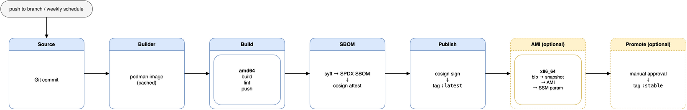

# bootc image pipeline on AWS (Terraform)

Continuously builds a bootc image from a Git repo with CodePipeline and CodeBuild, publishes it to ECR as a signed amd64 image, and optionally turns each build into an AMI.



| Tag | Meaning |
| --- | --- |
| `<commit12>-<exec8>` | Immutable build. Unique per run, so scheduled rebuilds of the same commit never overwrite each other. |
| `latest` (`channel_tag`) | Every successful build. |
| `stable` (`promotion_tag`) | Builds that passed manual approval. Point production hosts here. |

## Layout

```
terraform/          Root module: ECR, IAM, CodeBuild projects, CodePipeline V2, KMS, schedule, AMI import
buildspecs/         builder, build, sbom, publish, promote, ami — embedded into the CodeBuild projects by Terraform
builder/Containerfile   podman + skopeo + cosign + awscli image every build runs on
example/Containerfile   Minimal bootc image to drop into your source repo
example/rhel10/         RHEL 10 bootc image that enforces signatures and SBOM attestations on hosts
```

Your source repo only needs the Containerfile and whatever it copies in. Buildspecs live here, so changing how images are built is a `terraform apply`, not a commit to every image repo.

## Deploy

1. Put a Containerfile in your image repo (start from `example/Containerfile`).
2. For RHEL bases, create a Secrets Manager secret with a [registry service account](https://access.redhat.com/terms-based-registry/):
   ```bash
   aws secretsmanager create-secret --name rh-registry \
     --secret-string '{"username":"1234567|my-svc","password":"..."}'
   ```
3. Configure and apply:
   ```bash
   cd terraform
   cp terraform.tfvars.example terraform.tfvars   # edit repository_id, ...
   terraform init
   terraform apply
   ```
4. If Terraform created the Git connection, open **Developer Tools → Settings → Connections** in the console and finish the handshake once (`connection_status` goes from `PENDING` to `AVAILABLE`). The first pipeline run fails until then. Rerun it with "Release change".

The first run builds the builder image (a few minutes). After that the Builder stage is a skip until `builder/Containerfile` changes.

## Consume the image

**Switch a host to the pipeline's image:**

```bash
sudo bootc switch <image_repository_url>:stable
sudo bootc upgrade --apply   # or let bootc-fetch-apply-updates.timer do it
```

**Registry auth.** bootc reads `/etc/ostree/auth.json`. ECR tokens last 12 hours, so hosts need a refresh before each check for updates:

```ini
# /etc/systemd/system/ecr-auth.service  (run from a timer every 6h, and before bootc-fetch-apply-updates.service)
[Service]
Type=oneshot
ExecStart=/bin/sh -c 'aws ecr get-login-password --region us-east-1 | podman login --authfile /etc/ostree/auth.json --username AWS --password-stdin 111122223333.dkr.ecr.us-east-1.amazonaws.com'
```

Credentials depend on where the host runs:

- **On EC2:** attach `image_pull_policy_arn` to the instance profile.
- **Edge devices outside AWS:** use IAM Roles Anywhere so devices authenticate with an X.509 certificate instead of long-lived keys. Alternatively, mirror ECR into an on-site registry (Quay, Harbor) and point devices there.

**Signatures and SBOM attestations.** With `enable_signing`, Publish signs the image digest with the KMS key. With `enable_sbom` (the default), an SBOM stage runs before Publish: syft generates an SPDX SBOM for the image, and it is attached as a cosign attestation on the same digest, signed by the same key. The SBOM is also kept as the stage's `sbom` pipeline artifact. Because it runs first, `:latest` never points at an image without an attestation. Signatures and attestations are kept in ECR next to the image (`sha256-<digest>.sig` / `.att`), and nothing is uploaded to the public Rekor log.

**Enforce them on hosts.** `example/rhel10/` is a RHEL 10 image that does this for you. Copy that directory to the root of your image repo. The pipeline passes the repository URL, the KMS public key and the SBOM setting in as build args, so there is nothing to edit. It bakes in:

| File | Purpose |
| --- | --- |
| `/etc/pki/containers/bootc-image.pub` | The KMS public key. |
| `/etc/containers/policy.json` | RHEL's policy plus a `sigstoreSigned` requirement for this repository. Every pull of it by bootc or podman must be signed. |
| `/etc/containers/registries.d/bootc-image.yaml` | `use-sigstore-attachments: true`, so clients fetch the signature from ECR. |
| `/usr/lib/bootc-verify/sbom-policy.rego` | SBOM attestation policy: the attestation must be an SPDX 2.x document generated by syft, list packages, and include the `bootc` RPM (so the OS package database was scanned). |
| `/usr/libexec/bootc-verify-image` + a drop-in for `bootc-fetch-apply-updates.service` | Before each automatic upgrade, checks the signature and evaluates the signed SBOM attestation against `sbom-policy.rego`. If either check fails, the upgrade doesn't run. |

`policy.json` can only check signatures, which is why the attestation check runs as a pre-upgrade step. Its limits:
- It covers `bootc-fetch-apply-updates`, not a manual `bootc upgrade`.
- It resolves the tag just before bootc pulls, so a tag moved in between could slip through. That image would still need a valid signature.

Use `bootc switch --enforce-container-sigpolicy` for the first switch to the image. To check a build by hand:

```bash
terraform output -raw cosign_public_key > cosign.pub
cosign verify --key cosign.pub --insecure-ignore-tlog <image>@<digest>
cosign verify-attestation --key cosign.pub --insecure-ignore-tlog --type spdxjson \
  --policy example/rhel10/files/usr/lib/bootc-verify/sbom-policy.rego <image>@<digest>
```

**Launch from AMIs** (`enable_ami = true`). Each build writes its AMI ID to `/<name>/bootc/ami` in SSM Parameter Store. A launch template using `resolve:ssm:/<name>/bootc/ami` always gets the newest one. AMI hosts still update in place with `bootc upgrade`, so AMIs only matter for new instances.

## Notes and troubleshooting

- **Podman inside CodeBuild** relies on `privileged_mode` and on `quay.io/podman/stable` declaring `/var/lib/containers` as a volume, so overlay storage sits on a real filesystem. If a build fails with overlay mount errors, add `ENV STORAGE_DRIVER=vfs` to `builder/Containerfile`. This is slower but works anywhere.
- **bootc-image-builder needs loop devices.** The AMI stage checks for them up front and fails with a clear message if CodeBuild's managed hosts don't expose them. The fix is a CodeBuild reserved-capacity fleet (EC2 compute): create an `aws_codebuild_fleet` and add a `fleet { fleet_arn = ... }` block to the `environment` of `aws_codebuild_project.ami`.
- **Base image updates.** `rebuild_schedule` reruns the pipeline weekly with no commit, so CVE fixes in the base image reach hosts. `--pull=always` makes sure the build sees them.
- **Concurrency.** The pipeline uses the V2 default (superseded): a newer run replaces an older one waiting at the same stage, including at approval. Set `execution_mode = "QUEUED"` on `aws_codepipeline.bootc` if every build must be reviewed.
- **Retention.** ECR expires only untagged images (`untagged_image_expiry_days`). Tagged builds stay until you prune them, along with their signatures and attestations.
- **Cost drivers.** Builds use `BUILD_GENERAL1_LARGE` by default. Each AMI adds a 20–40 minute import plus snapshot storage. Leave `enable_ami` off unless you launch new instances from these images.

## Tear down

```bash
terraform destroy
```

The image repository is not force-deleted, so destroy stops while it still holds images. Empty it first, or set `force_delete = true` on `aws_ecr_repository.image`. AMIs and snapshots made by the pipeline aren't tracked in Terraform; deregister them separately.
